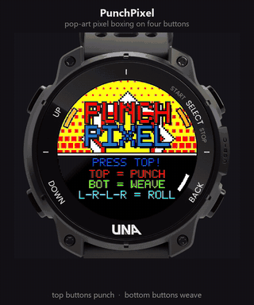

# PunchPixel

Pop-art pixel boxing for the [UNA Watch](https://unawatch.com), played on its four physical buttons.
Entry for the UNA App Development Competition, October 2026.



| Button | Action |
|---|---|
| L1 / R1 (top) | jab left / right, start, confirm |
| L2 / R2 (bottom) | weave left / right |
| hold R2 | pause; hold again on the pause screen to quit |

- **Read the tell.** The bezel flashes on the side a punch is coming from. Weave away from it.
- **Counter.** A jab right after a dodge is a critical hit.
- **Dempsey Roll.** Weave left-right-left-right to fill the meter, then punch: an 8-hit combo.
- **Four rivals**, each faster with longer combos. Finish ranked S to C by the health you keep.

Uses no sensors: buttons, screen, vibration motor and buzzer only.

## How it works

The whole game is drawn pixel by pixel in the display's 64-colour palette.
One full-screen LVGL object paints the frame straight into LVGL's render stripe
during `LV_EVENT_DRAW_MAIN`.

| Path | What |
|---|---|
| `Software/Libs/Sources/Game.cpp` | rules, timing, AI; pure C++, no kernel or LVGL |
| `Software/Libs/Sources/Scene.cpp` | draws a frame from the game state |
| `Software/Libs/Sources/Painter.cpp` | clipped rectangles, rings, bursts and a 5x7 font into RGB565 |
| `Software/Libs/Sources/Service.cpp` | service process: plays vibration and chiptune buzzer cues |
| `Software/Apps/LVGL-GUI/` | GUI process: input, ticking, the draw hook |
| `Software/Apps/LVGL-GUI/simulator/WatchHost.cpp` | PC simulator window showing the display inside the watch |

## Build

Needs the [UNA SDK](https://github.com/UNAWatch/una-sdk) with `UNA_SDK` pointing at it (forward slashes).

```powershell
# watch image (.uapp), with the SDK's ARM toolchain on PATH
cmake -S Software/Apps/PunchPixel-CMake -B Software/Apps/PunchPixel-CMake/build -G Ninja
cmake --build Software/Apps/PunchPixel-CMake/build

# host tests
cmake -S Tests/Host -B Tests/Host/build
cmake --build Tests/Host/build --config Debug
Tests/Host/build/Debug/punchpixel-host-tests.exe

# PC simulator (32-bit, uses the SDL2 TouchGFX ships)
python Tests/Sim/watch/fetch_watch.py          # optional: the watch frame around the display
cmake -S Software/Apps/LVGL-GUI/simulator -B Software/Apps/LVGL-GUI/simulator/build -A Win32
cmake --build Software/Apps/LVGL-GUI/simulator/build --config Debug
```

Simulator keys: `1` L1, `2` L2, `3` R1, `4` R2, `Esc` quit. `Tests/Sim/drive.ps1` plays it end to end and checks the sound and vibration log.

`Output/` holds the released build (`PunchPixel_1.0.0.uapp`, store ID `B4672B0D1F858124`).

## Licence

MIT, see [LICENSE](LICENSE). The watch photo in the previews and simulator belongs to UNA Watch Ltd.
